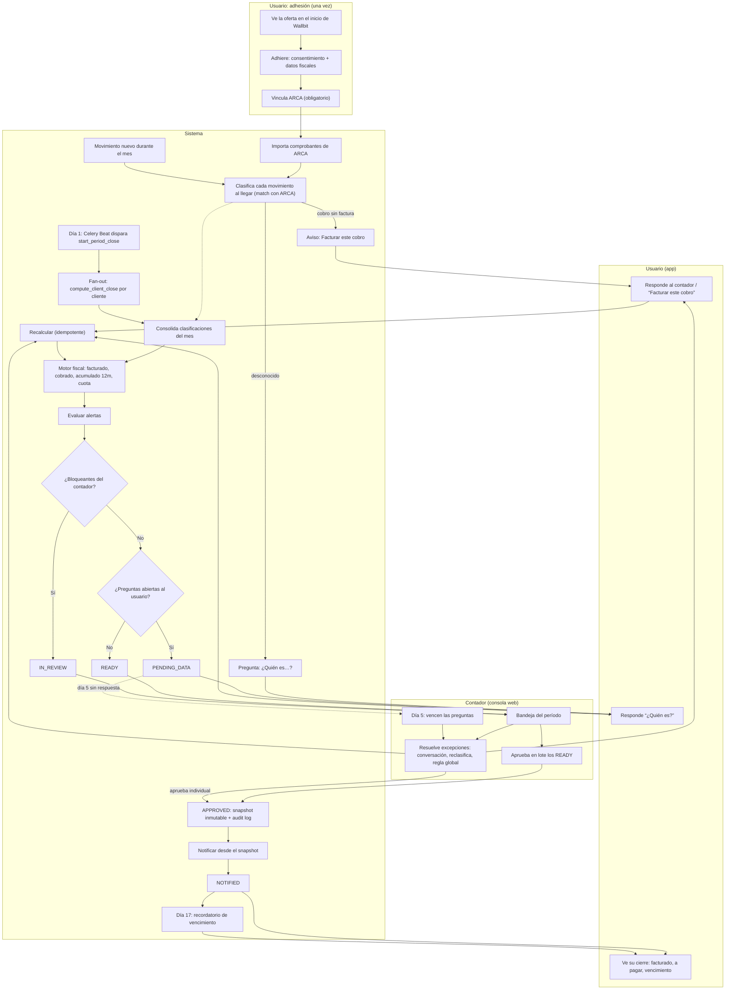
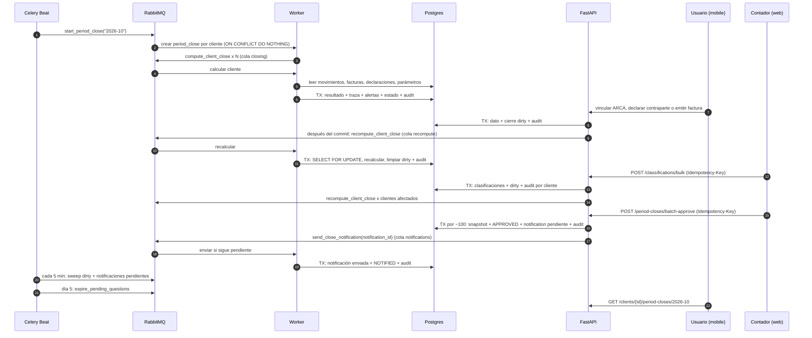
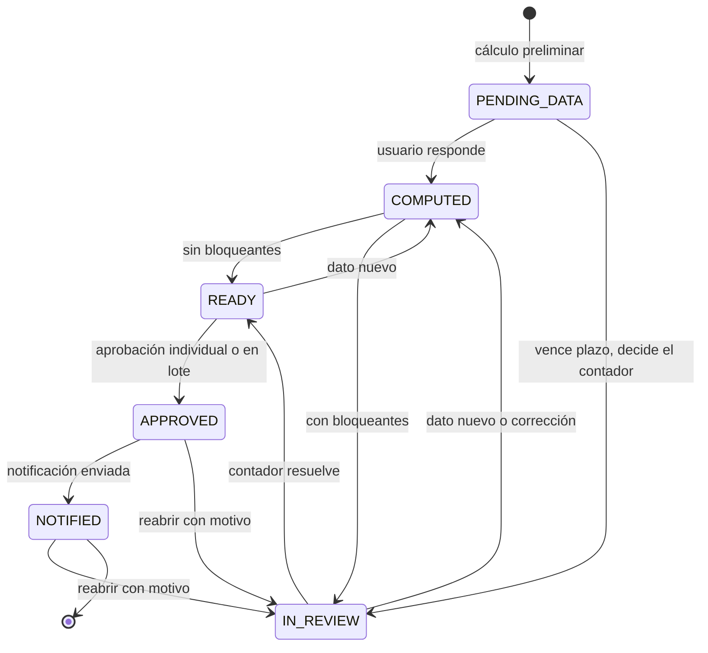
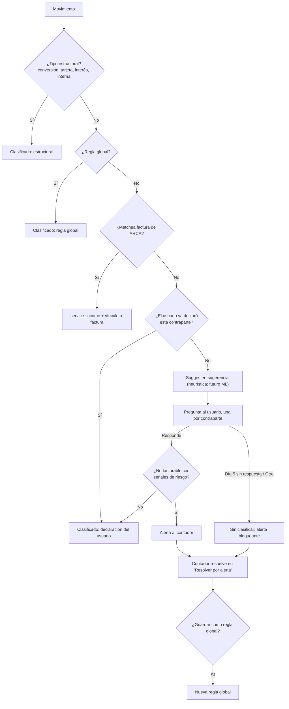

# Flujo general — Cierre de mes

## 1. Quién hace qué

| Herramienta (automático) | Contador (excepciones + firma) | Usuario (app Wallbit) |
|---|---|---|
| Importa las facturas de ARCA y dispara el cierre el día 1 para todos los clientes | Revisa solo los cierres `IN_REVIEW` | Adhiere al servicio: consentimiento + **vincula ARCA (obligatorio)** |
| Clasifica movimientos con reglas globales y match con facturas de ARCA | Valida por excepción, resuelve lo que el usuario no aclaró y crea reglas globales | Responde qué es cada contraparte desconocida |
| Calcula facturado, cobrado, acumulado 12 meses, cuota y vencimiento | Aprueba en lote los `READY` | Responde al contador; si falta una factura, la emite desde la app ("Facturar este cobro") |
| Detecta alertas y asigna estado | Reabre un cierre aprobado si hace falta (con motivo) | Recibe el aviso aprobado: facturado, a pagar, vencimiento |
| Recalcula cuando llega un dato nuevo | Mantiene parámetros fiscales y plantillas de mensajes | Recibe recordatorio antes del vencimiento |
| Congela snapshot, registra auditoría y notifica | | |

## 2. Flujo de punta a punta

## 3. Secuencia técnica

Postgres es la fuente de verdad; los mensajes solo llevan ids. Toda escritura de estado va con su evento de auditoría en la misma transacción, y se encola recién después del commit.

## 4. Estados del cierre (por cliente y período)

## 5. Clasificación por capas (sin reglas por cliente)

El contador no mantiene reglas por cliente: lo que solo sabe el usuario lo declara el usuario (una vez por contraparte) y el contador valida por excepción. Cada respuesta y cada validación queda como etiqueta para un modelo ML local futuro.

## 6. Calendario del cierre (ej. cierre de octubre 2026)

| Día de noviembre | Evento |
|---|---|
| 1–31 (mes en curso) | Cada movimiento se clasifica al llegar: avisos “Facturar este cobro” y preguntas “¿Quién es?” en el momento |
| 1 | Consolidación: motor fiscal, alertas y estado con las clasificaciones del mes |
| 1–5 | Usuarios responden o facturan desde la app → recálculos. Contador trabaja excepciones |
| 5 | Vence el plazo de las preguntas; las pendientes pasan al contador |
| 5–7 | Aprobación en lote y notificación |
| 17 | Recordatorio de vencimiento |
| 20 | Vencimiento de la cuota de monotributo |
